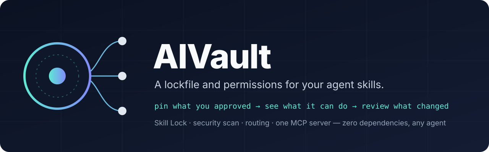

<p align="center">
  
</p>

<p align="center">
  <a href="https://github.com/Mohammed-051/AIVault/actions/workflows/ci.yml"></a>
  <a href="LICENSE"></a>
  
  
</p>

**AIVault** is a local library and router for agent skills, MCP servers and AI tooling.

You add a source by its repository URL. AIVault clones it into quarantine, scans it for malicious content, files it by type, classifies every skill it contains, and keeps a compact index. Agents use that index to load only the one to three skills a task needs.

It works with any agent that can read files or connect to an MCP server: Claude Desktop, Claude Code, Cursor, Windsurf, VS Code Copilot and others. It runs on Windows, macOS and Linux with Node.js 18+ and git, and has no other dependencies.

```console
$ vault add https://github.com/coreyhaines31/marketingskills
Cloning https://github.com/coreyhaines31/marketingskills.git…
Security ✓ CLEAN — marketingskills: 0 critical · 0 high · 0 medium · 3 low (815 files)
Added "marketingskills" → library/skills/marketingskills (skills)
  Skills: 53
  Domains: Content & marketing 39 · Business, legal & finance 4 · Software engineering 3 · …
Indexed 1074 skills · dashboard ≈ 1783 tokens.

$ vault route "write a launch post for AgriSphere"
Project memory: memory/agrisphere.md
Base skills (Writing, content, media, design, documents): library/skills/caveman-claude-skill/SKILL.md
Candidate skills (pick at most 2, open the path):
- launch [content-marketing] — When the user wants to plan a product launch, feature announcement…
  library/skills/marketingskills/skills/launch/SKILL.md
```

## Contents

- [Installation](#installation)
- [Usage](#usage)
- [How it works](#how-it-works)
- [Security model](#security-model)
- [Performance](#performance)
- [MCP server](#mcp-server)
- [Comparison](#comparison)
- [Documentation](#documentation)

## Installation

```bash
git clone https://github.com/Mohammed-051/AIVault.git
cd AIVault
```

| Platform | Command |
|---|---|
| Windows | double-click `setup.cmd`, or run `.\setup.cmd` |
| macOS / Linux | `sh setup.sh` |

The setup wizard:

- Checks for Node.js and git.
- Offers optional starter packs.
- Registers the MCP server with every supported client it finds: Claude Desktop (including the Microsoft Store build), Claude Code, Cursor, Windsurf and VS Code. Each config file is backed up before it's modified.
- Adds `vault` to your `PATH`.
- Copies a one-paragraph agent instruction to the clipboard.

Claude Desktop is closed and reopened automatically when its configuration changes. To run the setup again later, or for one client only, use `vault setup` or `vault connect --client <id>`.

## Usage

| Command | Description |
|---|---|
| `vault add <source>` | Add a source. Accepts `owner/repo`, a GitHub URL (including `/tree/<ref>/<dir>` for a single folder), any git URL, or a local directory |
| `vault add <source> --dry-run` | Scan and classify without adding |
| `vault add <source> --only a,b` | Keep only the named skills |
| `vault scan [name \| all \| url]` | Security-scan installed sources, or preview a repository |
| `vault route "<task>"` | Show what an agent would load for a task |
| `vault search <terms>` | Search all skills |
| `vault update [name]` | Fetch the latest versions; re-scan; roll back an update that fails |
| `vault new-project "<name>" --type <kind>` | Create a project memory file |
| `vault new-skill <name>` | Scaffold a skill in `local/skills/` |
| `vault link <skill>` | Expose a skill to Claude Code's native loader |
| `vault pack [name]` · `vault export [name]` | Install or share a list of sources |
| `vault doctor` | Check paths, pins, security status and token budgets |

With the MCP server connected, the same operations are available from chat. Pasting a repository link and asking the agent to add it runs `vault_add`.

## How it works

```text
source URL ─► quarantine clone ─► security scan ─► classify ─► library/<kind>/<name>
                                       │ blocked                      │
                                       ▼                              ▼
                                   discarded               catalog (.vault/catalog.json)
                                                                      │
                     dashboard.md  ◄──────────────  index/<domain>.md ◄┘
                          ▲                               ▲
     agent ── vault_route(task) ── returns 1–3 SKILL.md paths + project memory
```

### Design decisions

**Progressive disclosure.** Agents never read the library directly. They read two things:
- `dashboard.md`, about 1.7k tokens: protocol, pinned routes, domain map and projects.
- One `index/<domain>.md`, or a single `vault_route` call.

Only the selected `SKILL.md` files are loaded in full.

**Classification.** Each skill is scored against 19 domains using its name, path and description, and is placed in at most two. The domains span engineering, frontend, backend, systems, embedded, mobile, data/ML, DevOps/security, design, writing, marketing, media, office documents, research, productivity, business, learning, integrations and agent tooling. The taxonomy is plain data in `engine/lib/domains.mjs`.

**Index hygiene.**
- **Duplicates.** Identical or same-named skills from different sources are shown once, preferring local, then official, then community sources.
- **Families.** Large sets of near-identical skills, such as 832 `<app>-automation` skills, collapse to a single line and stay reachable through search.
- **Maintainer-only skills.** Skills an MCP-server repository keeps for its own developers are excluded unless you ask for them.

**Routing.** `vault_route` combines four things:
1. Project memory, when the task names a project.
2. Base skills per task type, for example a terse-output skill for code.
3. Keyword-pinned routes.
4. A BM25 search with stemming and synonym expansion. Weak single-word matches are discarded.

**Kind detection.** Repositories are filed as `skills`, `mcp`, `plugins`, `tools` or `catalogs`, based on their contents:
- `SKILL.md` files.
- MCP signals: the MCP SDK as a dependency, `mcpName`, `server.json` or `fastmcp`.
- Plugin manifests.
- Link density, for awesome-lists.

## Security model

Public skill registries have been used to distribute malware. Snyk's 2026 review of 3,984 skills found 76 confirmed malicious payloads, with 13.4% of skills carrying at least one critical issue ([ToxicSkills](https://snyk.io/blog/toxicskills-malicious-ai-agent-skills-clawhub/)). AIVault treats every source as untrusted:

- **Quarantine first.** Sources are cloned to `.vault/tmp/` and scanned before anything reaches `library/`. AIVault never executes code from a source.
- **36 static rules** cover:
  - remote code execution (`curl … | sh`, encoded PowerShell, base64-to-shell);
  - reverse shells, credential-store access, exfiltration endpoints;
  - prompt injection, including invisible Unicode and hidden HTML comments;
  - persistence mechanisms, disabled security controls, disguised binaries;
  - password-protected archives, npm install hooks and hard-coded keys.
- **Context-aware severity.** The same text is scored differently depending on where it appears:
  - full strength in instruction files an agent follows, and in scripts those files invoke;
  - reduced in human-facing documentation;
  - test and documentation directories are skipped unless an instruction file references them;
  - `curl | sh` is graded by URL: vendor installer low, unknown HTTPS domain medium, HTTP or raw IP critical.
- **Verdicts.**

  | Verdict | Condition | Effect |
  |---|---|---|
  | `clean` | no findings above low | added |
  | `caution` | medium findings only | added |
  | `review` | any high finding | added; skills marked ⚠ in every index; `vault_read` prepends a warning |
  | `blocked` | any critical finding | not added; override only from the CLI with `--allow-risky` |

- **Updates** are re-scanned, and rolled back automatically if the new version is blocked.
- **External scanners.** [NVIDIA SkillSpector](https://github.com/NVIDIA/skillspector) and [Cisco skill-scanner](https://github.com/cisco-ai-defense/skill-scanner) run automatically when installed, and their verdicts are merged.
- **The MCP server cannot override a block,** and `vault_read` cannot read outside the vault or inside `.git`.

**Calibration:**
- **24 popular repositories:** none are blocked, and one is flagged for review. They include Anthropic skills, Superpowers, everything-claude-code, the official MCP servers, GitHub MCP and Composio.
- **Test fixture** reproducing the published attack techniques: blocked with 5 critical and 6 high findings.

The full rule list and known limitations are in [docs/security.md](docs/security.md).

## Performance

Measured on a real vault with 17 sources and 1,020 skills:

| Metric | Value |
|---|---|
| `dashboard.md` | ≈ 1,700 tokens |
| Largest domain index | ≈ 2,400 tokens |
| `vault_route` response | ≈ 300 tokens |
| Security scan, 17 sources (≈ 16,000 files) | 6.3 s |
| Re-index | < 1 s |

## MCP server

`engine/mcp.mjs` implements the MCP stdio transport without an SDK. A single server provides:

| Tool | Purpose |
|---|---|
| `vault_route` | Files to load for a task: project memory, base skills, pinned routes, best matches |
| `vault_read` | Read a vault file by path (sandboxed, read-only) |
| `vault_memory` | List, read, or append to project memory |
| `vault_search`, `vault_list` | Discover skills and sources |
| `vault_add`, `vault_scan`, `vault_update`, `vault_remove` | Manage sources, all with security scanning |
| `vault_new_project`, `vault_doctor` | Project setup and health checks |

For clients that setup doesn't detect, print the configuration with `vault mcp-config`.

## Comparison

| | Installs skills | Search | Non-code domains | MCP servers, tools, catalogs | Security scanning | Project memory | Client setup |
|---|---|---|---|---|---|---|---|
| [`gh skill`](https://github.blog/changelog/2026-04-17-manage-agent-skills-with-github-cli/) | yes, with pinning | yes | — | — | preview only | — | — |
| [OpenSkills](https://github.com/numman-ali/openskills) | yes | — | — | — | — | — | — |
| [Vercel `skills`](https://github.com/vercel-labs/skills) | yes | yes | — | — | — | — | — |
| [claude-skills-mcp](https://github.com/K-Dense-AI/claude-skills-mcp) | — | embeddings | yes | — | — | — | — |
| [SkillSpector](https://github.com/NVIDIA/skillspector), [skill-scanner](https://github.com/cisco-ai-defense/skill-scanner) | — | — | — | — | deep (Python) | — | — |
| **AIVault** | yes, plus `vault link` | BM25, offline | 19 domains | yes | built in; uses the above when present | yes | 5 clients |

## Documentation

| Document | Contents |
|---|---|
| [docs/architecture.md](docs/architecture.md) | Directory layout, add pipeline, indexing and routing internals |
| [docs/security.md](docs/security.md) | Threat model, all rules, severity adjustments, calibration, limitations |
| [docs/configuration.md](docs/configuration.md) | `vault.json`: profiles, pinned routes, overrides, source defaults, security policy |
| [docs/mcp-tools.md](docs/mcp-tools.md) | MCP tools, supported clients, recommended agent instructions |

Starter packs live in [`packs/`](packs). There are 11, covering essentials, development, frontend design, writing, marketing, media, office documents, research, connectors, workflow and integrations.

## Contributing

Contributions are welcome. See [CONTRIBUTING.md](CONTRIBUTING.md). Scanner rules must come with two tests: a malicious sample and a benign look-alike. To report a vulnerability, follow [SECURITY.md](SECURITY.md) rather than opening a public issue.

## License

[MIT](LICENSE). Skills and servers added to a vault remain under their own licenses.

The scanner rules draw on research by [Snyk](https://snyk.io/blog/toxicskills-malicious-ai-agent-skills-clawhub/), [arXiv 2605.28588](https://arxiv.org/html/2605.28588), [NVIDIA](https://github.com/NVIDIA/skillspector) and [Cisco AI Defense](https://github.com/cisco-ai-defense/skill-scanner).
